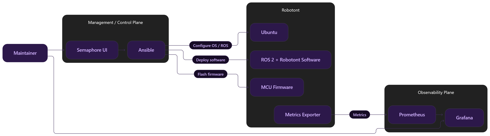

# Robotont Management

# Overview

Centralized management and monitoring for Robotont robots.

Initial scope:
- Provision Robotont computers using Ansible
- Update Robotont ROS software
- Update Robotont firmware
- Provide a simple management interface using Semaphore
- Monitor Robotont health using Prometheus and Grafana

Planned architecture:
- Ansible for configuration and deployment
- Semaphore as the management UI
- Prometheus for metrics collection
- Grafana for monitoring
- Docker Compose for management-server services

Future work may include:
- Automated Ubuntu installation
- Containerized Robotont runtime
- More advanced inventory management
- VPN / overlay networking
- Centralized logging

## Architecture


---


## Status (2026-09-27)

Robots are Docker-only: "1. Setup Ubuntu" prepares the host (network, hostname, udev, Wi-Fi,
Docker Engine) and "2. Deploy" puts the *workspaces* of this repository onto a robot, pulling the
images that GitHub Actions builds and pushes to GHCR. "3. Switch workspace" selects what runs:
the driver, a demo, later a student environment ([docs/07](docs/07-container-runtime.md)), and
"4. Run image" runs any container image on a robot as a workspace without touching the repository.
Monitoring: node_exporter on every robot, Prometheus and Grafana next to Semaphore with a fleet
dashboard and alert rules ([docs/10](docs/10-monitoring.md)).
Verified end to end on a Robotont 3 Lite (Raspberry Pi 5) with mainboard and lidar; the first
CI image build is pending a push. The upstream `robotont-setup` playbooks remain as
"Setup ROS (legacy)" for robots that keep ROS on the host (git submodules, [docs/06](docs/06-v1-reproduce-current-setup.md)).

## Quick start

Semaphore: `cp server/.env.example server/.env`, fill in the robot-side values, then
`docker compose -f server/compose.yaml up -d`. The project, keys, inventory, environment and the
tasks are created automatically ([docs/semaphore-setup.md](docs/semaphore-setup.md)); log in as
`admin` / `admin` at http://localhost:3000, run "1. Setup Ubuntu", then "2. Deploy"; the fleet
dashboard is at http://localhost:3001. What the host
machine needs (Docker, git, mDNS, the network) is in [docs/00-host-setup.md](docs/00-host-setup.md);
"0. Find robots" prints a robot's address when `robotont-N.local` does not resolve.

The same from a terminal:

```
git clone --recurse-submodules git@github.com:robotont/robotont-management.git
cd robotont-management
ansible-playbook playbooks/setup_ubuntu.yml -K -e robot_address=robotont-123.local -e robotont_id=123 -e robot_type=3lite -e robotont_camera=false \
  -e wifi_hotspot_password=... -e wifi_client_ssid=... -e wifi_client_password=...
ansible-playbook playbooks/deploy.yml -K -e robotont_id=123
ansible-playbook playbooks/switch_workspace.yml -K -e robotont_id=123 -e workspace=test-talker
```

## Repository layout

```
robot/                     deployed to /srv/robotont: workspaces/, images/ (Dockerfiles), releases/ (pinned sources), bin/
.github/workflows/         images.yml: builds robotont-ros per release and pushes to GHCR
playbooks/                 find_robots, setup_ubuntu, deploy, switch_workspace, run_image (Semaphore tasks 0 to 4); setup_ros (legacy);
                           status (command-line report until Grafana)
scripts/                   helpers (find_robots.py: TCP probe of a network; apply_patches.sh: patches onto the submodules)
roles/                     robotont_headless (Ubuntu Server prerequisites), robotont_host (hostname, udev, Wi-Fi),
                           docker, monitoring (node_exporter), robotont_workspaces
inventory/                 groups.yaml, robots/ (one file per enrolled robot, written by Setup Ubuntu), group_vars
server/                    Docker Compose for Semaphore (automatic bootstrap), Prometheus and Grafana (prometheus/, grafana/)
external/robotont-setup/   upstream playbooks for NUC robots (git submodule, pinned; legacy)
external/robotont-setup-rpi/  the same repository at the Raspberry Pi branch (git submodule, pinned; legacy)
patches/                   local patches applied to the submodule checkouts at run time (legacy)
test/                      sample environment for static checks
docs/                      analysis, mapping, plans, runbooks
```

## Documentation

| Document | Content |
|---|---|
| [docs/00-host-setup.md](docs/00-host-setup.md) | What the management host needs on Windows, macOS and Linux: Docker, git, mDNS, the network with the robots |
| [docs/01-repository-map.md](docs/01-repository-map.md) | Which repositories and branches matter, ROS 1 vs ROS 2, versioning conventions found |
| [docs/02-existing-ansible-analysis.md](docs/02-existing-ansible-analysis.md) | How `robotont-setup` provisions a robot today, task by task, and what blocks fleet use |
| [docs/03-provisioning-steps-mapping.md](docs/03-provisioning-steps-mapping.md) | Every post-install step and where it lands in the fleet roles and playbooks |
| [docs/04-software-firmware-versioning.md](docs/04-software-firmware-versioning.md) | Software deployment and versioning, firmware flashing options, monitoring signals |
| [docs/05-implementation-plan.md](docs/05-implementation-plan.md) | Decisions, target layout, steps with tests, upstream fixes, open questions (later phases) |
| [docs/06-v1-reproduce-current-setup.md](docs/06-v1-reproduce-current-setup.md) | Legacy host-ROS setup: how the upstream playbooks run from here, the submodules, test log |
| [docs/07-container-runtime.md](docs/07-container-runtime.md) | Workspaces: switching, images and CI, devices, monitoring hooks, runbook, phases, test log |
| [docs/semaphore-setup.md](docs/semaphore-setup.md) | The local Semaphore: automatic setup, the tasks and their dialog fields |
| [docs/08-hardware-test-guide.md](docs/08-hardware-test-guide.md) | Step-by-step manual verification on a robot: host setup, workspaces, known issues |
| [docs/10-monitoring.md](docs/10-monitoring.md) | node_exporter on the robots, Prometheus and Grafana next to Semaphore, the fleet dashboard, alert rules |
