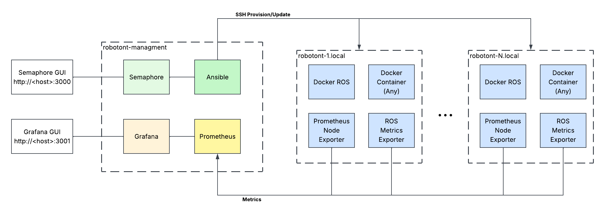

# Robotont Management

Robotont Management sets up and runs a fleet of Robotont robots from one computer. You install
Ubuntu on a robot once. After that, you set the robot up, give it its software, choose what it
runs, and watch its state from a web page. No manual work on the robot is needed.

It is built for the Robotont 3 (Intel NUC) and the Robotont 3 Lite (Raspberry Pi 5) of the
University of Tartu. It works from a Windows, macOS or Linux computer.

## What you can do

- Set up a new robot in about five minutes: network, hostname, devices, Docker.
- Deploy the robot software as Docker images, built automatically by GitHub.
- Switch what a robot runs: the standard driver, a demo, a test, or any container image you name.
- See every robot on one dashboard: online or not, last seen, what it runs, its devices, its health.
- Bring an older robot, set up by hand or by the old scripts, under the same management.

## How it works



1. **Robotont.** Each robot runs Ubuntu Server and Docker. The robot software runs in
   containers. In this project, a *stack* is a set of containers that run together, for
   example the driver alone, or the driver plus a demo. Exactly one stack is active on a
   robot at a time. The images come from the GitHub Container Registry; the robot never builds
   them. Two small exporters report the state of the robot every 15 seconds.
2. **Management host.** Any computer on the same network as the robots. It runs three services
   in Docker: Semaphore, the web page with the jobs you run against a robot; Prometheus, which
   collects the state of every robot; and Grafana, the dashboard. All three start with one
   command and configure themselves.
3. **Repository.** The Ansible playbooks behind the jobs, the stack definitions, the image
   recipes, and the list of robots. The list of robots is one small file per robot under
   `inventory/robots/`. The jobs read it, and the monitoring follows it automatically.

## Prerequisites

The management computer needs Docker with Compose and git. Nothing else: Ansible runs inside a
container. Pick your platform.

### Linux (Ubuntu 24.04)

```
sudo apt update
sudo apt install -y git docker.io docker-compose-v2 avahi-daemon libnss-mdns
sudo usermod -aG docker $USER
```

Log out and in again, then check:

```
docker compose version
```

`avahi-daemon` and `libnss-mdns` let your computer resolve the robots' names (`robotont-N.local`).
Ubuntu Desktop has them already; Ubuntu Server does not.

### macOS

1. Install Docker Desktop from https://www.docker.com/products/docker-desktop/ and start it.
2. Install git: open Terminal and run `git --version`; macOS offers to install the command line tools.
3. Check in Terminal:

```
docker compose version
```

Robot names resolve on macOS without extra software.

### Windows 10 or 11

1. Open PowerShell as administrator and run `wsl --install`. Restart the computer and create the
   Linux user when the Ubuntu window asks for it.
2. Install Docker Desktop from https://www.docker.com/products/docker-desktop/. In its settings,
   under Resources, WSL integration, enable the Ubuntu distribution.
3. Open the Ubuntu terminal (search for "Ubuntu" in the Start menu) and run:

```
sudo apt update
sudo apt install -y git
docker compose version
```

Work inside the Ubuntu terminal from now on, including the `git clone` below, and keep the
repository in the Linux home directory, not under `/mnt/c`. Robot names resolve on Windows
without extra software.

### Manual steps

These are the only steps done by hand. Everything after them is a job in Semaphore.

- **Prepare the SD card** with Raspberry Pi Imager:
  - operating system: Ubuntu Server 24.04 LTS (64-bit);
  - hostname: `robotont-N`, where N is the robot number (1 to 254);
  - user: `peko`, with the password you choose (`peko:<password>`);
  - SSH: enabled, with public key authentication and your public key;
  - Wi-Fi: the lab network, if there is one.
- **Boot the robot on a network with internet**: the lab Wi-Fi, or a cable to a router. The
  first boot installs the name service; without internet the robot never answers to
  `robotont-N.local`.
- **Write the secrets file** `server/.env` on the management computer:
  - the path to your private SSH key;
  - the `peko` password;
  - the Wi-Fi password of the robot hotspot, and the lab Wi-Fi name and password.
  The file is never committed.
- **Log the robot in to the image registry**, as long as the image package on GitHub is private:
  `ssh peko@robotont-N.local docker login ghcr.io`, with a read-only token. Once per robot, after
  "1. Setup Ubuntu".
- **Use a shared network.** The lab Wi-Fi or a router with DHCP is the normal case. A cable from
  the robot into your computer works on a bench if you enable connection sharing on the computer.
  A phone hotspot does not work: it isolates its clients from each other.

Semaphore and Grafana open with `admin` / `admin`. They are reachable only from the management
computer unless you set `SEMAPHORE_BIND=0.0.0.0` in `server/.env`. The `peko` password is the
only robot secret, and only the maintainer needs it.

## Start

```
git clone --recurse-submodules https://github.com/robotont/robotont-management.git
cd robotont-management
cp server/.env.example server/.env        # fill in the values
docker compose -f server/compose.yaml up -d
```

Open http://localhost:3000 for the jobs and http://localhost:3001 for the dashboard. Run the
same `up -d` command again after you change `server/.env` or add a stack.

## Add a robot

1. Write the card as described above, put it into the robot, and boot it on a network with internet.
2. Wait about two minutes, then check that `robotont-N.local` answers to `ping`. If it does not,
   run the job "0. Find robots": pick your network from the dropdown, or type it in "Other
   network" (for example `192.168.1.0/24`), and use the address the job prints.
3. Run "1. Setup Ubuntu" with the address, the robot number, the robot type and whether the
   camera is fitted. The job takes about five minutes and reboots the robot once.
4. Run "2. Deploy" with the robot number. The robot pulls its images and starts the `driver`
   stack. On a slow connection the pull takes a few minutes; the image is about 4 GB.

The robot now appears on the dashboard. Commit the new file under `inventory/robots/` so that
the list of robots is shared.

## Jobs

Every job works on one robot. A job runs again safely; it only changes what differs.

### 0. Find robots

Scans a network for robots when `robotont-N.local` does not answer, and prints their addresses.

| Input | Meaning | Example |
|---|---|---|
| Network | A network of your computer, from a dropdown | `192.168.1.0/24` |
| Other network | A network not in the dropdown, written as CIDR (at most /22); overrides the dropdown | `10.42.0.0/24` |

### 1. Setup Ubuntu

Prepares the operating system of a new robot and records the robot in the list. The job takes
about five minutes and reboots the robot once. Run it again to change the number of a robot.

| Input | Meaning | Example |
|---|---|---|
| Robot address | The IP or the name of the robot | `192.168.1.21`, `robotont-123.local` |
| Robot number | 1 to 254; becomes the hostname `robotont-N`, the ROS domain `N` and the hotspot address `192.168.200.N` | `123` |
| Robot type | Robotont 3 Lite (Raspberry Pi 5) or Robotont 3 (Intel NUC) | `Robotont 3 Lite` |
| Camera | Whether the IMX500 AI camera is fitted (Lite only) | `no` |

### 2. Deploy

Installs or updates the robot software: the stacks, the tools and the robot service. On the
first deploy the robot pulls its images (about 4 GB) and starts the `driver` stack.

| Input | Meaning | Example |
|---|---|---|
| Robot number | A robot prepared by "1. Setup Ubuntu" | `123` |

### 3. Switch stack

Stops the active stack and starts another one. The change survives a reboot.

| Input | Meaning | Example |
|---|---|---|
| Robot number | A robot deployed by "2. Deploy" | `123` |
| Stack | A stack from the repository; `host` runs the ROS installed on the robot itself (old robots) | `driver`, `demo-example` |

### 4. Run image

Runs any container image as a stack with the standard settings: host network, the ROS
environment, and optional access to the mainboard, lidar and gamepad. Use it for experiments and
quick demos. A stack that needs more, such as several containers or volumes, belongs in the
repository under `robot/stacks/`.

| Input | Meaning | Example |
|---|---|---|
| Robot number | A robot deployed by "2. Deploy" | `123` |
| Image | The image to run | `traefik/whoami:v1.11.0`, `ghcr.io/org/app:tag` |
| Name | The stack name (lowercase letters, digits, hyphens); empty takes it from the image | `whoami` |
| Command | Replaces the command of the image; empty keeps it | `ros2 run demo_nodes_cpp talker` |
| Hardware access | `yes` mounts `/dev` and allows the mainboard, lidar and gamepad | `no` |

### Without a job

- **Remove a robot**: delete its file under `inventory/robots/` and run `up -d`.
- **Bring in an old robot** with ROS installed on it: "1. Setup Ubuntu", then "2. Deploy". Its
  ROS stays usable as the stack `host`.

## The dashboard

Grafana lists every robot with its state and shows four alerts: robot down, service not active,
a device claimed but not present, and a device claimed twice. Alerts are shown on the page, not
sent anywhere.

## Writing a stack

A stack is a directory under `robot/stacks/` with a `compose.yaml`. Copy `demo-example`,
rename the directory (lowercase letters, digits and hyphens), replace the extra service, and say
in a label which devices the service opens. Run "2. Deploy" on a robot, then "3. Switch
stack". The dropdown in Semaphore lists the directories after the next `up -d`.

## When something does not work

| Symptom | Likely cause |
|---|---|
| `robotont-N.local` never answers | The robot had no internet at its first boot. Use "0. Find robots" and the address; "1. Setup Ubuntu" installs the name service. On macOS and Windows the dropdown cannot list your computer's networks: type the network in "Other network". |
| A job says "Connection refused" or "unreachable" | Wrong address, the robot is off, or on a Linux bench the firewall of the shared connection. Check `ssh peko@<address>` from your computer first. |
| "1. Setup Ubuntu" fails at the Docker install | A fresh robot is still installing its own updates. Wait a few minutes and run the job again. |
| "2. Deploy" fails at the pull | The robot has no internet, or the image package is private and the robot is not logged in. |
| The dashboard shows a robot offline | The robot is off or unreachable. The "last seen" column tells you since when. |
| A device shows as missing | The cable or the power of the mainboard or lidar. Plug it back in; the robot picks it up without a restart. |

## Repository layout

```
playbooks/        the jobs: find_robots, setup_ubuntu, deploy, switch_stack, run_image
roles/            what the jobs do on a robot
inventory/        the list of robots and their defaults
robot/            what is deployed to a robot: stacks, image recipes, release files, tools
server/           Docker Compose for Semaphore, Prometheus and Grafana
scripts/          helpers, including check.sh, the static checks that also run in CI
external/         the upstream robotont-setup playbooks (submodules), kept for old robots
notes/            working notes of the project, not needed to use it
```